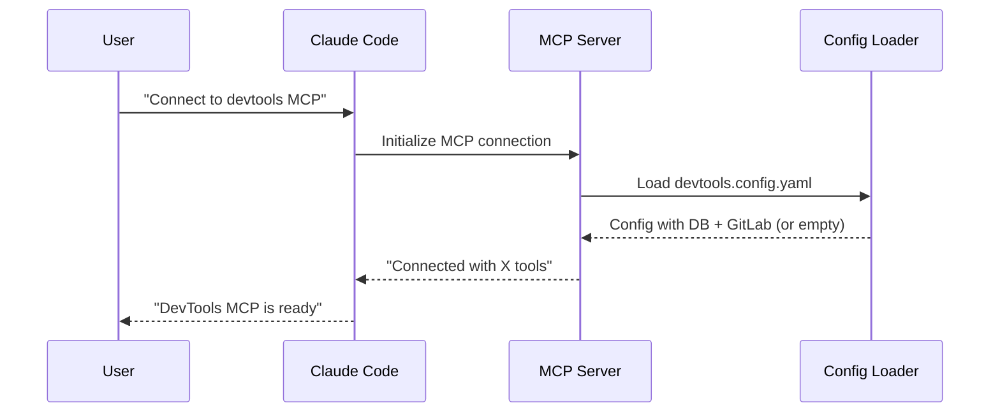
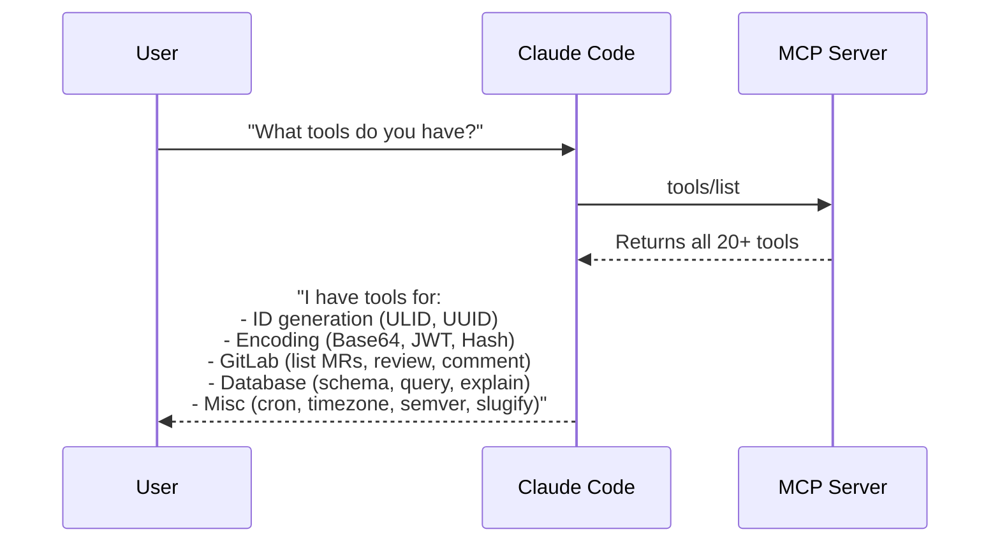
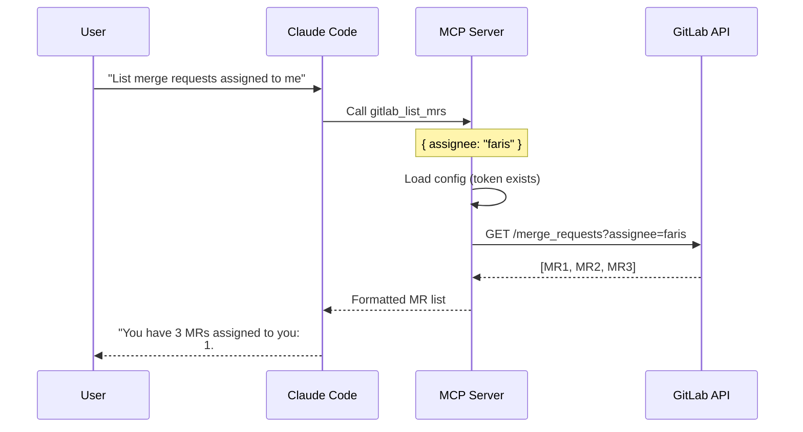
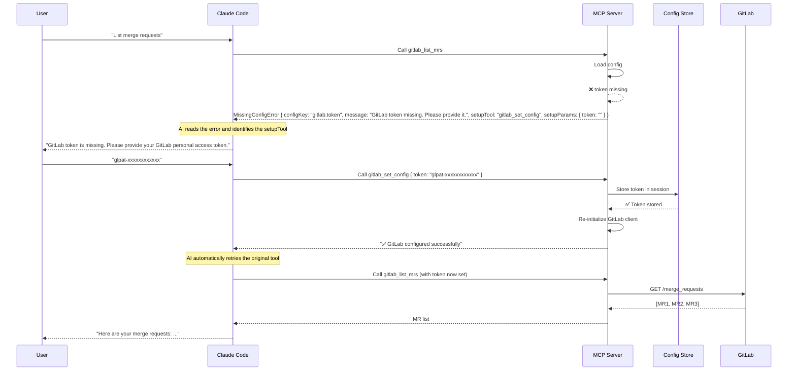
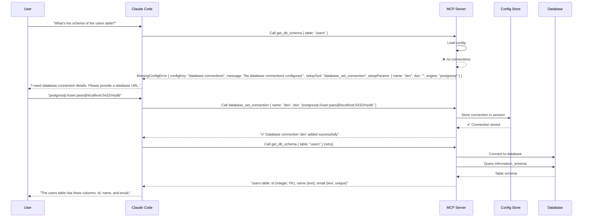
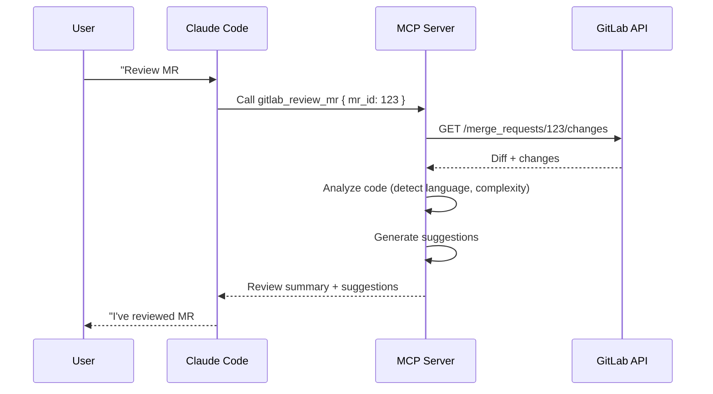
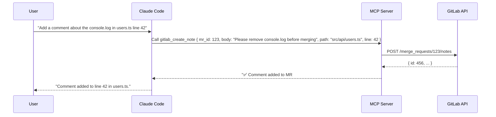
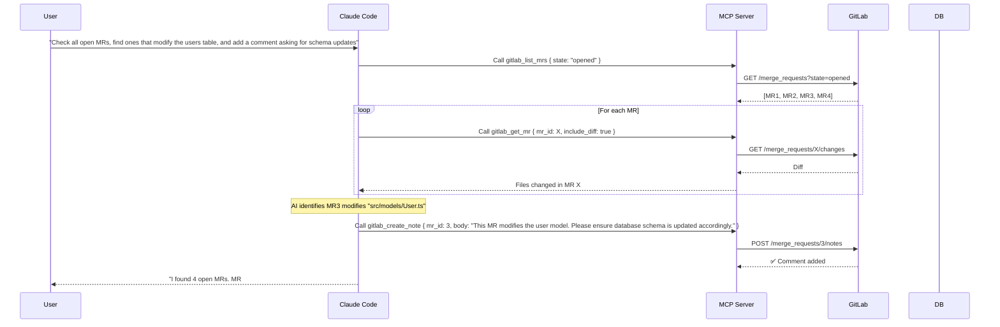

# 🧰 DevTools MCP

> **Developer companion** for AI coding assistants — generate IDs, encode, decode, parse, and introspect your stack without leaving your editor.

[](https://www.npmjs.com/package/@muhfaris/devtools)
[](https://opensource.org/licenses/MIT)
[]()

---

## ✨ What is DevTools MCP?

**DevTools MCP** is a [Model Context Protocol (MCP)](https://modelcontextprotocol.io) server that brings a rich set of developer utilities directly into your AI coding assistant (Claude Code, Cursor, etc.) and your terminal.

**Stop context-switching** to browser tabs for:
- Generating ULIDs, UUIDs
- Encoding/decoding Base64, JWT
- Generating hashes (MD5, SHA1, SHA256, SHA512)
- Testing regular expressions
- Generating secure secrets (passwords, API keys)
- Parsing cron expressions
- Converting timezones
- Bumping semantic versions
- Slugifying strings

Everything is available as:
- **MCP tools** – callable by your AI agent (`/mcp` in Claude Code)
- **CLI commands** – runnable directly from your terminal (`npx @muhfaris/devtools generate-ulid`)

---
## AI Interaction Flow
### MCP Server Connection

If Config Missing:
```
AI: "DevTools MCP is connected. I notice GitLab and Database are not configured yet.
     You can configure them when needed."
```
### AI Tool Discovery

### Gitlab Tool Flow


### Gitlab Tool Flow (no token)

### Database Tool Flow (no config)

### Review MR with Code Analysis


### Add Comment to MR


### Multi-Tool

---

## 🚀 Quick Start

### Install globally (for CLI use)
```bash
npm install -g @muhfaris/devtools
devtools generate-ulid
```

### Or use instantly with `npx` (no install)
```bash
npx @muhfaris/devtools generate-ulid --count 3
```

### Add to Claude Code (project-scoped)
```bash
claude mcp add devtools --project -- npx @muhfaris/devtools
```
Then in Claude Code, type:  
> *"Generate a ULID using devtools"*

### Add to Cursor
Add this to your `~/.cursor/mcp.json` or project `.cursor/mcp.json`:
```json
{
  "mcpServers": {
    "devtools": {
      "command": "npx",
      "args": ["@muhfaris/devtools"]
    }
  }
}
```

---

## 🛠️ Tools

### Phase 1: ID Generators

| Tool | Description | CLI Example |
| :--- | :--- | :--- |
| `generate_ulid` | Generate ULID(s) | `devtools generate_ulid --count 5` |
| `generate_uuid` | Generate UUID v4(s) | `devtools generate_uuid --count 3` |

### Phase 2: Encoding & Security

| Tool | Description | CLI Example |
| :--- | :--- | :--- |
| `base64_encode` | Encode string to Base64 | `devtools base64_encode --text "Hello"` |
| `base64_decode` | Decode Base64 to string | `devtools base64_decode --encoded "SGVsbG8="` |
| `jwt_decode` | Decode JWT token | `devtools jwt_decode --token "eyJ..."` |
| `hash_generate` | Generate MD5/SHA1/SHA256/SHA512 | `devtools hash_generate --text "hello" --algorithm sha256` |
| `secret_generate` | Generate secure random secret | `devtools secret_generate --length 32 --format base64` |
| `regex_test` | Test regex against a string | `devtools regex_test --pattern '^[a-z]+$' --text "hello"` |

### Phase 2: Misc Utilities

| Tool | Description | CLI Example |
| :--- | :--- | :--- |
| `cron_parse` | Parse cron expression, show next runs | `devtools cron_parse --expression "0 9 * * *" --count 5` |
| `timezone_convert` | Convert timestamp between timezones | `devtools timezone_convert --to "Asia/Jakarta"` |
| `semver_bump` | Bump semantic version | `devtools semver_bump --version "1.2.3" --bump minor` |
| `slugify` | Convert string to URL-safe slug | `devtools slugify --text "Hello World!"` |

---

## ⚙️ Configuration

Create a `devtools.config.yaml` in your project root (or any parent directory) to set defaults:

```yaml
id_generator:
  default: ulid          # default ID type when not specified

database:                 # Phase 4+ (coming soon)
  default_engine: postgresql
  connections:
    dev:
      dsn: ${DEV_DATABASE_URL}
      readonly: false

security:
  execute_query:
    allow_write: false
    blocked_env: [production]
```

---

## 🧪 Development

### Clone & install
```bash
git clone https://github.com/muhfaris/devtools-mcp.git
cd devtools-mcp
bun install
```

### Run in development mode
```bash
# CLI mode
bun dev generate-ulid

# MCP mode (stdio server)
bun dev
```

### Build for production
```bash
bun run build
bun dist/index.js generate-ulid
```

### Run tests
```bash
bun test
bun test --coverage    # with coverage
```

### Debug with MCP Inspector
```bash
# Run directly from source (no build needed)
bunx @modelcontextprotocol/inspector bun src/index.ts

# Or from built version
bun run build
bunx @modelcontextprotocol/inspector bun dist/index.js
```
The Inspector opens a browser UI at `http://localhost:5173` where you can:
- See all registered tools
- Call tools with custom parameters
- Inspect raw JSON‑RPC messages

### Adding a new tool
1. Create a new file under `src/tools/<category>/`.
2. Export a `Tool` object with `name`, `description`, `params`, and `execute`.
3. Import and register it in `src/tools/index.ts`.
4. Add tests in `tests/unit/tools/<category>/`.
5. Rebuild and test.

Example tool:
```typescript
// src/tools/misc/example.ts
import { Tool } from "../../core/types.js";

export const exampleTool: Tool = {
  name: "example_tool",
  description: "Does something useful",
  params: {
    input: { type: "string", description: "Input value" },
    count: { type: "number", optional: true, description: "How many", default: 1 }
  },
  execute: async (params) => {
    // ... your logic
    return { content: [{ type: "text", text: "result" }] };
  }
};
```

---

## 📦 Publishing to npm

```bash
npm login
npm publish --access public
```

After publishing, users can run:
```bash
npx @muhfaris/devtools generate-ulid
```

---

## 🗺️ Roadmap

| Phase | Tools | Status |
| :--- | :--- | :--- |
| **Phase 1** (v0.1) | ULID, UUID generators | ✅ Done |
| **Phase 2** (v0.2) | Base64, JWT, Hash, Regex, Secret, Cron, Timezone, Semver, Slugify | ✅ Done |
| **Phase 3** (v0.3) | Git helpers (commit, PR description, branch name) | 📋 Planned |
| **Phase 4** (v0.4) | Database introspection (schema, query, explain) | 📋 Planned |
| **Phase 5** (v0.5) | Dummy data generation (schema-aware) | 📋 Planned |
| **Phase 6** (v0.6) | Code intelligence (AST, OpenAPI generation) | 📋 Planned |

---

## 📄 License

MIT © [Faris](https://github.com/muhfaris)

---

## 🤝 Contributing

Contributions are welcome! Please open an issue or PR for:
- Bug fixes
- New tools (see the roadmap)
- Documentation improvements
