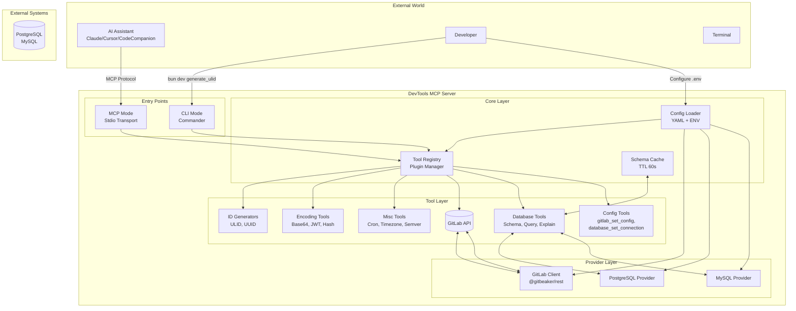
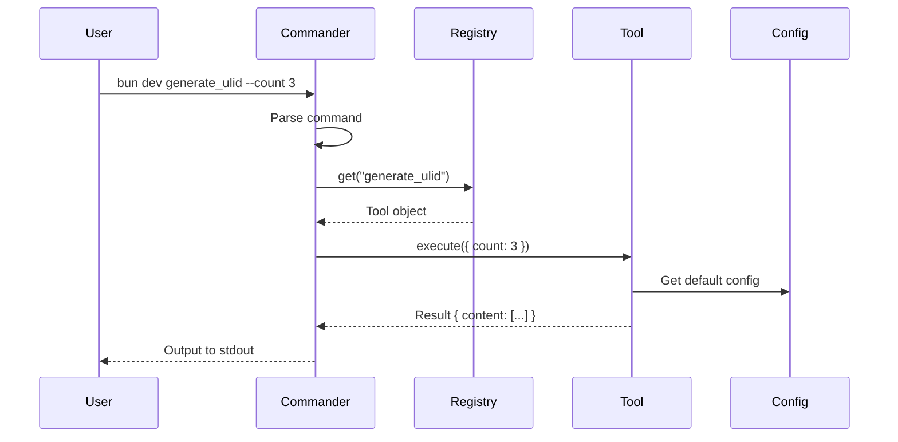
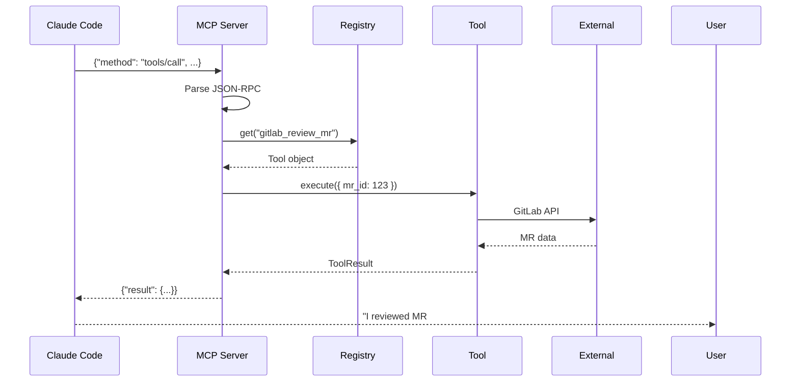
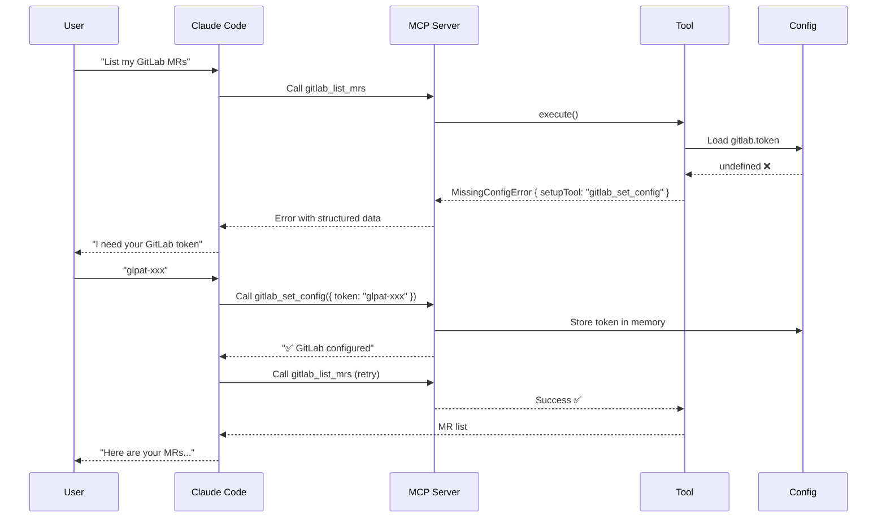

# Architecture

> Understanding the design, components, and flow of the DevTools MCP server.

## Overview

**DevTools MCP** is a Model Context Protocol (MCP) server that provides a
collection of developer utilities as tools callable by AI assistants.

### What problem does it solve?

1. **Context switching** — developers leave their editor for browser tools
   (UUID generators, JWT debuggers, cron parsers, etc.)
2. **AI hallucination** — AI agents guess database schemas, ID formats, and
   conventions instead of knowing the truth
3. **Fragmented tools** — no single interface for common development tasks
4. **Manual code review** — AI can analyze code but lacks Git platform integration

### Key differentiators

| Feature | DevTools MCP | Other MCP servers |
| :--- | :--- | :--- |
| Database introspection | Real schema awareness | Static or none |
| GitLab integration | Full MR lifecycle | Limited or none |
| Interactive config | AI asks for missing credentials | Hardcoded config only |
| Plugin architecture | Add tools without touching core | Often monolithic |
| Dual mode | MCP + CLI | Usually one or the other |

## Core principles

1. **Plugin-based architecture** — each tool is an independent module
2. **Provider abstraction** — database engines and external services behind interfaces
3. **Stateless but cache-aware** — tools stateless, optional caching for introspection
4. **Security first** — read-only defaults, production blocking, never log credentials
5. **Interactive configuration** — missing credentials trigger structured errors AI can resolve

## Architecture diagram



## Component breakdown

### Entry points (`src/index.ts`)

Single entry point that detects runtime mode:

```typescript
if (isCliMode) {
  program.command(tool.name).action(...)
} else {
  await startMcpServer(registry)
}
```

### Core layer

#### Tool registry (`src/core/registry.ts`)

The heart of the plugin system:

```typescript
class ToolRegistry {
  private tools = new Map<string, Tool>()
  register(tool: Tool)          // Add a tool
  get(name: string)             // Retrieve a tool
  list(): Tool[]                // List all tools
  async execute(name, params)   // Run a tool
}
```

#### Config loader (`src/core/config.ts`)

Loads configuration from `.devtools/config.yaml` (auto-discovered up the
directory tree), resolves `${ENV_VAR}` placeholders, and watches the file for
live reload. See [Configuration](./Configuration.md).

### Tool layer

Each tool is a self-contained module implementing the `Tool` interface:

```typescript
interface Tool {
  name: string
  description: string
  params?: Record<string, ToolParamSchema>
  execute: (params: ToolParams) => Promise<ToolResult>
}
```

### Provider layer

Abstracts external systems behind interfaces:

```typescript
interface DBProvider {
  connect(config: ConnectionConfig): Promise<void>
  introspect(tableName?: string): Promise<SchemaInfo>
  executeQuery(query: string, params?: any[]): Promise<any[]>
  explainQuery(query: string): Promise<any>
  healthCheck(): Promise<boolean>
}
```

Supported providers: PostgreSQL, MySQL/MariaDB, GitLab.

### MCP server (`src/mcp/server.ts`)

Handles the MCP protocol, auto-converts tool params to Zod schemas, and
returns errors gracefully (`isError: true`).

## Execution flow

### CLI mode



### MCP mode



### Interactive config flow (missing credentials)



## Plugin system

1. **Registration** — each tool calls `registry.register()` on startup
2. **Discovery** — the registry exposes `list()` for MCP and CLI
3. **Execution** — tools invoked by name via `registry.execute()`

## Provider abstraction

- **Decoupling** — tools don't care if they talk to PostgreSQL or MySQL
- **Testability** — mock providers for unit tests
- **Extensibility** — new databases added without refactoring

## Security model

### Database

| Feature | Implementation |
| :--- | :--- |
| Read-only by default | `execute_query` blocks writes unless `allow_write: true` |
| Production blocking | Prevents writes on `production`, `prod`, `staging` |
| No credential leaks | DSN values never logged |
| Connection limits | `pool_size` limits concurrent connections |

### GitLab

| Feature | Implementation |
| :--- | :--- |
| Token security | Tokens from env vars, never hardcoded |
| No token echo | Tokens never appear in responses |
| Rate limiting | Respects GitLab API limits |

### Configuration

| Feature | Implementation |
| :--- | :--- |
| `.env` ignored | Never commit secrets to version control |
| Environment variables | Preferred for credentials |
| Interactive config | Session-only (not persisted) |

## Error handling & interactive config

When a tool can't run due to missing configuration, it throws a
`MissingConfigError`:

```typescript
throw new MissingConfigError(
  "gitlab.token",        // Which config key is missing
  "GitLab token missing", // Human-readable message
  "gitlab_set_config",   // Tool to call to fix it
  { token: "" }          // Parameters for the setup tool
)
```

The AI reads the error, extracts `setupTool`/`setupParams`, asks the user for
credentials, calls the setup tool, then retries the original tool.

## Testing strategy

### Unit tests (`tests/unit/`)

| Test file | Covers |
| :--- | :--- |
| `core/registry.test.ts` | Tool registration, lookup, execution |
| `tools/id-generators/*.test.ts` | ULID, UUID generation |
| `tools/encoding/*.test.ts` | Base64, JWT, hash, secret, regex |
| `tools/misc/*.test.ts` | Cron, timezone, semver, slugify |
| `tools/gitlab/*.test.ts` | GitLab tools (mocked) |
| `tools/database/*.test.ts` | Database tools (mocked) |

### Mock strategy

- **Database** — mock the provider interface
- **GitLab** — mock `@gitbeaker/rest` client
- **File system** — mock `fs` where needed

## Glossary

| Term | Definition |
| :--- | :--- |
| **MCP** | Model Context Protocol — a standard for AI tools |
| **Tool** | A function an AI can call (e.g., `generate_ulid`) |
| **Provider** | An abstraction for external systems (database, GitLab) |
| **Registry** | The central store of all registered tools |
| **Stdio** | Standard input/output — how MCP communicates |
| **JSON-RPC** | The protocol format used by MCP |
| **Zod** | A TypeScript schema validation library |
| **Introspection** | Querying database metadata (schemas, tables, columns) |
| **`MissingConfigError`** | Structured error for interactive config |

## Further reading

- [Configuration](./Configuration.md)
- [MCP clients](./MCP-Clients.md)
- [Tools](./Tools.md)
- [Development](./Development.md)
- [Product requirements](./PRD.md)

